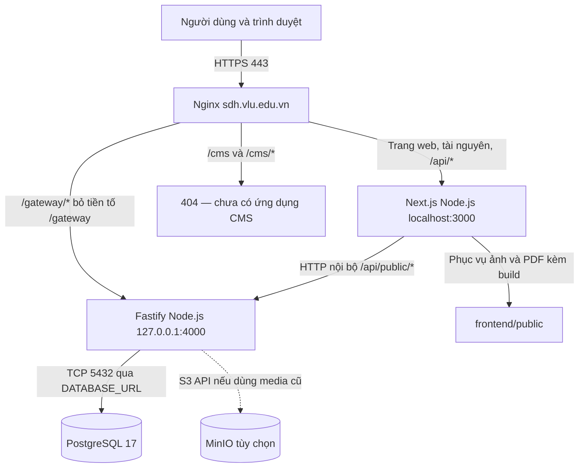

# Bàn giao triển khai website Sau đại học trên Linux

Ngày lập: 28/10/2026. Địa chỉ triển khai: **https://sdh.vlu.edu.vn**.

Bộ bàn giao dành cho đội hạ tầng vận hành bằng bản build, không yêu cầu truy cập Git hoặc biên dịch source. Phương án: Nginx kết thúc HTTPS, FE Next.js chạy Node.js cổng 3000, BE Fastify chạy Node.js cổng 4000, PostgreSQL 17 lưu dữ liệu. Docker chỉ dùng tại máy dev để tạo bản build Linux; máy triển khai không cần Docker.

**Phạm vi bản hiện tại là website công khai. Không có ứng dụng CMS, đăng nhập quản trị hoặc API quản trị. `/cms` trả 404 có chủ đích. Muốn nghiệm thu CMS phải có hạng mục phát triển/bàn giao riêng; thêm cấu hình Nginx không tạo ra CMS.**

Bản working tree dùng để build hiện chủ động ẩn giao diện `/vi/news`, `/en/news` và `/vi/student-success`, `/en/student-success` cùng các trang con (trả 404). API public tin tức vẫn tồn tại. Phạm vi hiển thị này cần được chủ sản phẩm xác nhận khi chốt release.

## 1. Mô hình và luồng kết nối



| Đường dẫn bên ngoài | Đích nội bộ | Vai trò |
|---|---|---|
| `/`, `/vi`, `/en`, các trang nội dung | FE cổng 3000, giữ nguyên URI | Giao diện, render và dữ liệu trang |
| `/api/consultations` | FE → BE `/api/public/consultations` | Form tư vấn, BE kiểm tra và lưu DB |
| `/api/analytics/visit` | FE → BE `/api/public/visits` | Ghi nhận lượt truy cập; tối đa 30 request/IP/phút, body 4 KiB |

| `/api/media/<key>` | FE → BE `/api/public/media/<key>` | Đọc media MinIO nếu có cấu hình |
| `/gateway/api/public/news` | BE `/api/public/news` | API danh sách tin |
| `/gateway/api/public/resources` | BE `/api/public/resources` | API tài liệu |
| `/gateway/health` | BE `/health` | Kiểm tra tiến trình |
| `/gateway/ready` | BE `/ready` | Kiểm tra kết nối DB bằng `SELECT 1` |
| `/cms`, `/cms/*` | Nginx trả 404 | Chưa có CMS trong bản bàn giao |

Lưu ý bảo vệ API (rà soát 29/10/2026):

- Fastify chỉ tin `127.0.0.1` và `::1`. Nginx phải ghi đè `X-Forwarded-For` bằng `$remote_addr`; Next.js chuyển header này tới backend. Chỉ mở Nginx ra Internet, giữ cổng 3000/4000 nội bộ. Nếu proxy nằm ở máy/container khác, cần khai báo đúng địa chỉ proxy tin cậy trong `backend/src/app.ts`, không bật lại `trustProxy: true`.
- Visits giới hạn 30 request/IP/phút trước khi ghi DB; trả 429 và `Retry-After` khi vượt quota. Bộ đếm nằm trong bộ nhớ từng tiến trình, reset khi restart; nhiều replica cần kho đếm dùng chung hoặc quota ở ingress. Đây không phải chống bot phân tán hoàn chỉnh và không thay thế chính sách lưu trữ/xóa dữ liệu analytics.
- Source hiện không có endpoint upload, multipart hoặc presigned upload. Media chỉ GET/download. Giữ body limit mặc định 1.000.000 byte và Nginx `1m`; khi bổ sung upload phải đặt giới hạn riêng cho route và location Nginx tương ứng.
- Sharp được đồng bộ về `0.35.5` trong manifest/lockfile, vá advisory [libheif](https://github.com/lovell/sharp/security/advisories/GHSA-rgj7-g3m4-5g8c) và [librsvg](https://github.com/lovell/sharp/security/advisories/GHSA-wq5f-xc86-pv6w). Cần build lại artifact trước khi triển khai; các gói bàn giao đã tạo trong `outputs/` không tự cập nhật theo source.

`/gateway` là tiền tố do Nginx cung cấp, không phải một ứng dụng gateway độc lập. Backend hiện dùng `/api/public/...`, không dùng `/gateway/...` trong route. Ví dụ `/gateway/api/public/news` mới là URL đúng; `/gateway/news` không phải endpoint hiện có. Nginx có dấu `/` cuối `proxy_pass` để loại bỏ tiền tố `/gateway/`.

FE đang gọi API cùng origin tại `/api/...` và gọi BE từ Node.js bằng `BACKEND_INTERNAL_URL`. Vì vậy giữ nguyên tuyến `/api/...` tới FE; không chuyển toàn bộ `/api` trực tiếp sang BE. FE không kết nối PostgreSQL. Không đưa mật khẩu DB vào trình duyệt.

Mẫu cấu hình giả định Nginx, FE và BE cùng một máy; DB có thể cùng máy hoặc máy riêng. Nếu có WAF/load balancer trước Nginx, IT cần cấu hình real IP chỉ cho dải IP proxy tin cậy, chứng chỉ và chuyển tiếp HTTPS theo hạ tầng thực tế. Không tin trực tiếp `X-Forwarded-For` do client gửi.

## 2. Thành phần bàn giao và yêu cầu máy chủ

| Thành phần | Nội dung / điều kiện |
|---|---|
| `builds/fe-linux-amd64.tar.gz` | Next.js standalone, dependencies chạy, `.next/static`, ảnh/PDF `public`; entrypoint `frontend/server.js` |
| `builds/be-linux-amd64.tar.gz` | JavaScript BE đã biên dịch, Prisma client và dependencies; entrypoint `backend/dist/server.js`; seed `backend/dist/seed-public.mjs` |
| `builds/SHA256SUMS` | Kiểm tra tính toàn vẹn hai bản build |
| `config/*.env.example` | Mẫu môi trường, không có secret thật |
| `config/sdh.nginx.conf` | HTTPS, tuyến FE, gateway và dự phòng CMS |
| `config/vgg-*.service` | Hai service systemd tự khởi động lại khi lỗi |
| `sql/01-schema.sql` | SQL PostgreSQL tạo enum, bảng, index, khóa ngoại từ migration hiện tại |
| `VERIFICATION.txt` | Kết quả kiểm tra của chính gói build và các bước còn phải nghiệm thu |

Máy chạy ứng dụng: Linux **x86_64, glibc**, tương thích Debian 12; Node.js **26.12.1**, OpenSSL và CA certificates. Không dùng gói này cho ARM64, Alpine/musl hoặc Windows. DB: PostgreSQL 17. Web server: Nginx có hỗ trợ TLS. Không cần npm install, Git, Prisma CLI hay TypeScript trên máy IT. Đường dẫn Node trong service là `/usr/local/bin/node`; sửa cả hai service nếu `command -v node` trả đường dẫn khác.

FE được bàn giao theo Node.js server, không phải SPA export tĩnh: bản hiện tại dùng Next server rendering và route handlers. Standalone vẫn chứa JavaScript thực thi của ứng dụng; yêu cầu không truy cập repository không đồng nghĩa mã JavaScript là mã hóa.

Các gói được build cho domain `sdh.vlu.edu.vn`. Một số metadata/trang tĩnh có thể được tạo lúc build; nếu đổi domain phải yêu cầu dev build lại và kiểm tra canonical/sitemap, không chỉ đổi `.env` lúc chạy.

## 3. Cấu hình môi trường

Sao chép mẫu thành `/etc/vgg/frontend.env` và `/etc/vgg/backend.env`; IT điền thông tin thật bằng kênh quản lý secret. Không gửi mật khẩu qua tài liệu hoặc gói ZIP.

| Biến | Nơi đặt | Giá trị và ý nghĩa |
|---|---|---|
| `NODE_ENV` | FE, BE | `production` |
| `PUBLIC_APP_URL` | FE, BE | `https://sdh.vlu.edu.vn`, không thêm `/gateway` hoặc dấu `/` cuối |
| `HOSTNAME`, `PORT` | FE | `localhost`, `3000` |
| `NODE_OPTIONS` | FE | `--dns-result-order=ipv4first` để bind loopback IPv4, khớp upstream Nginx `127.0.0.1:3000` |
| `BACKEND_INTERNAL_URL` | FE | `http://127.0.0.1:4000`, không thêm `/api` hay `/gateway`; nếu BE ở máy khác thay bằng IP/DNS nội bộ BE |
| `BACKEND_HOST`, `BACKEND_PORT` | BE | `127.0.0.1`, `4000`; nếu FE/Nginx ở máy khác, bind IP riêng thích hợp và giới hạn firewall |
| `DATABASE_URL` | BE | `postgresql://vgg:URL_ENCODED_PASSWORD@DB_HOST:5432/vgg_public`; thay DB_HOST bằng IP/DNS PostgreSQL thực tế |
| `VGG_DEMO_NEWS`, `VGG_DEMO_RESOURCES` | FE | `false`; không bật fallback demo khi nghiệm thu |
| `STORAGE_ENDPOINT` | BE, tùy chọn | Host MinIO, không gồm `http://` hoặc path |
| `STORAGE_PORT`, `STORAGE_USE_SSL` | BE, tùy chọn | Cổng S3 API và chuỗi `true`/`false` chính xác |
| `STORAGE_BUCKET` | BE, tùy chọn | Bucket tồn tại, ví dụ `vgg-media` |
| `STORAGE_ACCESS_KEY`, `STORAGE_SECRET_KEY` | BE, tùy chọn | Cấu hình cùng nhau hoặc bỏ cả hai |

`127.0.0.1` và `localhost` luôn chỉ chính máy chạy tiến trình. Riêng FE dùng `HOSTNAME=localhost` để khớp cách Next.js chuẩn hóa URL trong middleware locale, kèm `NODE_OPTIONS=--dns-result-order=ipv4first` để lắng nghe IPv4. Nginx dùng upstream `127.0.0.1:3000` và sửa Location redirect nội bộ thành domain công khai. Không tự đổi hostname FE mà bỏ qua kiểm tra rewrite `/vi`, `/en` và redirect. Nếu DB ở máy khác, chỉ thay host/port trong `DATABASE_URL`; không thay địa chỉ FE thành DB. Mật khẩu chứa ký tự đặc biệt phải percent-encode khi đưa vào URL. Nếu DB bắt buộc TLS, cấu hình chuỗi kết nối và CA theo chính sách IT, không vô hiệu hóa xác thực chứng chỉ.

Ảnh/PDF đi kèm build không cần MinIO. Chỉ khi dữ liệu import còn trỏ `/api/media/...` mới phải cung cấp bucket và media tương ứng; nếu bỏ storage, các URL media đó trả 503. Bucket và DB là hai hạng mục sao lưu riêng.

## 4. Khởi tạo PostgreSQL

Chạy bằng tài khoản vận hành PostgreSQL, với host/cổng đúng môi trường. Ví dụ DB cùng máy:

```sh
createuser -h 127.0.0.1 -p 5432 -U postgres --pwprompt --no-superuser --no-createdb --no-createrole vgg
createdb -h 127.0.0.1 -p 5432 -U postgres --owner=vgg --encoding=UTF8 vgg_public
psql -h 127.0.0.1 -p 5432 -U vgg -d vgg_public -W -v ON_ERROR_STOP=1 --single-transaction -f sql/01-schema.sql
```

SQL dành cho **database mới, trống**; chỉ chạy một lần. Không chạy lên DB cũ, không reset/xóa DB đang vận hành. `--single-transaction` và `ON_ERROR_STOP` giúp rollback nếu khởi tạo lỗi. Schema có các bảng `news_posts`, `resource_categories`, `resource_files`, `site_contents`, `page_visits`, `consultations`, `consultation_history`.

Luồng bàn giao này áp SQL trực tiếp, không tạo lịch sử `_prisma_migrations`. Những bản nâng cấp sau phải có SQL nâng cấp riêng; nếu chuyển sang Prisma migrate thì dev cần baseline migration đã áp, không chạy lại migration khởi tạo.

Sau khi giải nén BE và cấu hình môi trường, nạp nội dung khởi tạo bằng chương trình đã build:

```sh
sudo -u vgg /usr/local/bin/node --env-file=/etc/vgg/backend.env /opt/vgg/current/be/backend/dist/seed-public.mjs
```

Seed tạo nội dung trang, tin tóm tắt và tài liệu mẫu đi kèm; không tạo tài khoản CMS hoặc người đăng ký giả. Seed không ghi đè bản ghi đã có. Phải duyệt nội dung trước khi đưa lên production. Khi chuyển dữ liệu từ hệ thống cũ, dev cần bàn giao bản export đã kiểm tra, mapping và media; SQL schema không chứa dữ liệu cũ. Không yêu cầu đội IT đọc hoặc chạy source seed TypeScript.

## 5. Cài đặt các bản build

Thực hiện từ thư mục bộ bàn giao đã giải nén. Dùng thư mục release mới cho mỗi lần triển khai; ví dụ `20261028-01`. Không ghi đè bản đang chạy.

```sh
cd builds
sha256sum -c SHA256SUMS
cd ..
# Tạo một lần nếu tài khoản/thư mục chưa tồn tại.
sudo useradd --system --user-group --home-dir /opt/vgg --shell /usr/sbin/nologin vgg
sudo install -d -m 0755 /opt/vgg/releases/20261028-01/fe /opt/vgg/releases/20261028-01/be
sudo tar -xzf builds/fe-linux-amd64.tar.gz -C /opt/vgg/releases/20261028-01/fe
sudo tar -xzf builds/be-linux-amd64.tar.gz -C /opt/vgg/releases/20261028-01/be
sudo chown -R vgg:vgg /opt/vgg/releases/20261028-01
sudo ln -s /opt/vgg/releases/20261028-01 /opt/vgg/current
sudo install -d -o root -g vgg -m 0750 /etc/vgg
sudo install -o root -g vgg -m 0640 config/frontend.env.example /etc/vgg/frontend.env
sudo install -o root -g vgg -m 0640 config/backend.env.example /etc/vgg/backend.env
```

Các lệnh tạo user, symlink và copy `.env` trên dùng cho lần đầu; không chạy lại để ghi đè cấu hình thật. Điền secret trước khi seed hoặc khởi động. Systemd đọc file môi trường; chạy tay thì phải dùng `node --env-file=...` vì file cấu hình nằm ngoài thư mục ứng dụng.

Sau khi tạo schema và seed thành công:

```sh
sudo install -m 0644 config/vgg-frontend.service config/vgg-backend.service /etc/systemd/system/
sudo systemctl daemon-reload
sudo systemctl enable --now vgg-backend
curl --fail http://127.0.0.1:4000/ready
sudo systemctl enable --now vgg-frontend
curl --fail http://localhost:3000/vi
```

Nếu PostgreSQL là dịch vụ trên cùng máy, có thể bổ sung quan hệ `After` với tên service PostgreSQL đúng bản phân phối. `/ready` mới phản ánh khả năng truy vấn DB; `/health` không đủ để kết luận DB hoạt động hoặc schema đã đầy đủ.

## 6. Nginx và mạng

IT cấp DNS `sdh.vlu.edu.vn` trỏ về frontend gateway, cùng chứng chỉ TLS hợp lệ. Chỉnh đường dẫn chứng chỉ trong `config/sdh.nginx.conf`, sau đó:

```sh
sudo install -m 0644 config/sdh.nginx.conf /etc/nginx/conf.d/sdh.conf
sudo nginx -t
sudo systemctl reload nginx
```

Chỉ reload khi `nginx -t` thành công. Gỡ cấu hình server_name trùng nếu có sau khi IT xác minh. File phải được include bên trong khối `http` của Nginx. Mẫu này kết thúc TLS trực tiếp tại Nginx; cần điều chỉnh nếu TLS kết thúc ở gateway phía trước.

| Kết nối | Cổng | Phạm vi |
|---|---|---|
| Người dùng → Nginx | 443; 80 để redirect | Internet/intranet theo chính sách trường |
| Nginx → FE | 3000 | Loopback hoặc mạng riêng |
| Nginx/FE → BE | 4000 | Loopback hoặc mạng riêng |
| BE → PostgreSQL | 5432 | Chỉ máy BE và tài khoản vận hành được phép |
| BE → MinIO tùy chọn | 9000 hoặc cổng TLS thực tế | Mạng riêng |

Không mở trực tiếp 3000/4000/5432 ra Internet. Với DB tách máy, IT cấu hình `listen_addresses`, `pg_hba.conf` và firewall chỉ cho địa chỉ cần thiết. Fastify đang tin proxy nên phải giữ BE phía sau proxy tin cậy. MinIO console 9001 không cần công khai. Một số ảnh/nội dung có URL ngoài hệ thống; việc cho phép egress cần đối chiếu nội dung đã duyệt.

## 7. Kiểm tra và nghiệm thu

```sh
curl --fail https://sdh.vlu.edu.vn/gateway/health
curl --fail https://sdh.vlu.edu.vn/gateway/ready
curl --fail https://sdh.vlu.edu.vn/gateway/api/public/news
curl --fail https://sdh.vlu.edu.vn/gateway/api/public/resources
curl --fail https://sdh.vlu.edu.vn/vi
curl --fail https://sdh.vlu.edu.vn/en
```

Kiểm tra bằng trình duyệt: menu, chương trình, trang tuyển sinh, tài liệu, tìm kiếm/lọc, tải PDF, form tư vấn và VI/EN. Mục tin tức và câu chuyện học viên đang ẩn nên kỳ vọng 404; chỉ nghiệm thu giao diện tin chi tiết khi dev bật lại trong release tương ứng. Gửi một yêu cầu tư vấn thử được đánh dấu rõ, xác nhận bản ghi mới trong `consultations`; restart BE và xác nhận dữ liệu còn. Kiểm tra gateway trả 400 với form không hợp lệ. Kiểm tra `/cms` trả 404 đúng phạm vi hiện tại. Kiểm tra canonical, sitemap và robots dùng domain dự kiến. Không kết luận nghiệm thu chỉ từ trang chủ 200 vì FE có nội dung fallback.

Kiểm tra khả năng khởi động lại máy, tự chạy service, log, chứng chỉ và kết nối storage nếu dùng. `/ready` không kiểm tra đầy đủ bảng/index, nội dung seed hoặc MinIO; API đọc dữ liệu và thử form là các bước bổ sung bắt buộc.

## 8. Vận hành và rollback

```sh
sudo systemctl status vgg-backend vgg-frontend
sudo journalctl -u vgg-backend -u vgg-frontend --since '30 minutes ago'
pg_dump -h DB_HOST -U vgg -d vgg_public -Fc -f vgg_public.backup
```

Giữ backup PostgreSQL, media nếu có, cấu hình secret và các bản build theo chính sách IT. Thử restore trên DB riêng trước khi nghiệm thu backup. Log có thể chứa dữ liệu vận hành, chỉ cấp quyền phù hợp.

Khi nâng cấp, giải nén vào thư mục release mới, kiểm tra checksum và SQL nâng cấp, backup DB, rồi đổi symlink `current` và restart cả hai service trong cửa sổ bảo trì. Giữ lại đường dẫn release cũ. Rollback ứng dụng bằng đổi `current` về bản cũ chỉ khi schema DB còn tương thích; nếu không phải có kế hoạch rollback/restore dữ liệu riêng, không tự động khôi phục DB làm mất dữ liệu vừa ghi.

## 9. Trách nhiệm trước khi đưa lên production

Dev bàn giao build đã kiểm thử, checksum, phiên bản, SQL, cấu hình mẫu, kết quả nghiệm thu và dữ liệu được duyệt. IT cấp máy Linux tương thích, Node, PostgreSQL, DNS/TLS, tài khoản DB, firewall, secret, Nginx, systemd, backup và monitoring. Hai bên xác nhận cấu hình trên máy thật và phạm vi CMS còn thiếu.

Tài liệu kỹ thuật nền: [Next.js standalone output](https://nextjs.org/docs/app/api-reference/config/next-config-js/output), [Nginx reverse proxy](https://docs.nginx.com/nginx/admin-guide/web-server/reverse-proxy/).

## 10. Quy trình tạo lại bản build dành cho đội dev

Chạy từ checkout đã chốt và đã lấy file Git LFS thật; không chuyển checkout cho IT:

```sh
docker build --platform linux/amd64 -f deploy/handover/Dockerfile --output type=local,dest=outputs/sdh-handover/builds .
```

Dockerfile chỉ bật standalone trong bản sao build, không sửa cấu hình source làm việc. Bộ bàn giao IT chỉ gồm tài liệu, config, SQL và hai archive; không cần gửi Dockerfile hoặc script build. Mỗi bản phát hành cần kèm commit gốc, tình trạng thay đổi chưa commit, checksum archive và báo cáo kiểm thử. Không coi bản working tree là bản release Git đã phê duyệt.
