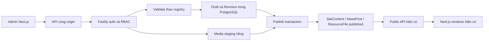

# Kiến trúc CMS đề xuất

Trạng thái: thiết kế để review; chưa triển khai. Căn cứ `CMS_CURRENT_STATE.md` và mã nguồn được dẫn tại đó.

## Lựa chọn

| Phương án | Ưu điểm | Hạn chế/độ phức tạp | Chi phí vận hành |
|---|---|---|---|
| Mở rộng Next.js + Fastify + Prisma đang có — khuyến nghị | Tái dùng renderer, patch, schema, DB, public API; ít thay đổi hợp đồng | Phải xây auth, workflow, media metadata, admin; mức vừa | Hai tiến trình và DB hiện tại; tăng storage/backup/monitoring theo sử dụng |
| CMS headless tự host độc lập | Có thể cung cấp editor/workflow sẵn | Cần khảo sát sản phẩm/giấy phép riêng; mapping patch/collections, auth, migration và thêm dịch vụ; mức cao | Thêm dịch vụ, backup và công vận hành; chưa định giá |
| Nội dung qua Git và build lại | Version history sẵn, ít thay đổi runtime | Khó cho đội biên tập; publish phụ thuộc build; preview/media/RBAC vẫn cần làm; mức thấp lúc đầu nhưng không khớp trải nghiệm yêu cầu | CI/build và công hỗ trợ biên tập |

Khuyến nghị mở rộng ứng dụng hiện tại. Không có nhu cầu kỹ thuật đã chứng minh để thay framework hoặc đưa thêm CMS server. Pilot có thể dùng input/textarea + renderer rich text hiện có; chưa cần thư viện WYSIWYG. Các dependency bổ sung cho session/cookie, hash mật khẩu và multipart sẽ chốt sau khi xác định SSO và cách upload; phải kiểm tra tài liệu/giấy phép chính thức trước pin phiên bản. Không đưa ra báo giá hay cam kết giấy phép cho sản phẩm chưa chọn.

## Luồng mục tiêu

Admin `/admin` không có locale trong URL, chọn locale trong editor; cần ngoại lệ rõ trong `proxy.ts`. Root layout hiện chứa public chrome/analytics nên phải tách public providers/chrome sang layout nhóm public hoặc cơ chế tương đương, chỉ sau khi có baseline; giữ nguyên CSS và markup public. Admin API đi cùng origin qua Next proxy mỏng, quyền do Fastify quyết định. Không coi việc ẩn nút UI là kiểm soát quyền.

Dùng registry typed theo từng page ID/locale và source version. Tái dùng contentFields, compositionSchema, collectionSchemas, bannerSchema; không tạo engine page builder thứ hai. Trước mỗi module, đối chiếu registry với renderer để loại trường không render và thêm field đang hardcode cần thiết. Không cho người biên tập sửa selector, CSS, JS hay field kỹ thuật.

## Nháp, preview, xuất bản

Save ghi revision nháp; public tiếp tục đọc snapshot cũ. Preview dùng cùng renderer và dữ liệu nháp được xác thực phía server, không thay global state/public cache, không truyền draft vào API công khai. Mỗi request preview kiểm tra session và quyền; đặt `no-store`, `noindex`, không analytics, không referrer chứa token.

Publish kiểm tra quyền, expectedVersion, schema, media rồi transaction cập nhật snapshot public + publishedRevisionId + audit. Nháp khác không ảnh hưởng snapshot. Restore tạo nháp từ revision lịch sử rồi mới publish nếu cần. Các file/object cần chuẩn bị trước commit vì storage không nằm trong transaction SQL; lỗi copy không được cập nhật snapshot, object thừa dọn sau theo retention.

`website-content.ts` hiện fallback về source khi lỗi; cần quyết định rõ theo loại nội dung. Trang marketing có thể dùng bản tốt gần nhất; nội dung bị ẩn/thu hồi không được hồi sinh từ source defaults. Đề xuất lưu trạng thái page/ngành published cùng snapshot và có tombstone cho archive; lúc backend lỗi hiển thị trạng thái không khả dụng cho nội dung cần thu hồi chắc chắn. Không mặc định xóa SiteContent là gỡ trang: reader hiện sẽ quay về defaults.

## Media

Giữ ảnh/PDF trong public để tương thích. Upload mới qua abstraction storage, dùng MinIO/S3-compatible đã có khi được cấu hình; nếu IT muốn filesystem cần adapter riêng và backup được xác nhận. Không tự bật object storage hay đổi env. Draft/private assets ở bucket hoặc vùng không thể truy cập bằng `/api/public/media/*`; public asset được promote sang key bất biến sau validation. Thay ảnh tạo key mới tránh cache cũ; xóa mềm và kiểm tra reference trong cả draft/revision/public trước xóa vật lý.

Đề xuất pilot: JPEG/PNG/WebP tối đa 10 MiB; PDF tối đa 25 MiB khi triển khai tài liệu, xác minh chữ ký file, kích thước ảnh, tên an toàn. Đây là giới hạn thiết kế, chưa có trong app. Không cho SVG/HTML upload công khai ở pilot. Cần tăng body limit chỉ ở route upload hoặc dùng upload staging có giới hạn, không tăng toàn server.

## Xác thực, dữ liệu và mở rộng

Chưa tìm thấy auth có thể tái dùng trong repo. Ưu tiên SSO sẵn có nếu vận hành xác nhận; fallback tài khoản nội bộ + mật khẩu hash chuẩn qua thư viện được duy trì, opaque session lưu hash server, cookie HttpOnly/Secure/SameSite, rotate/revoke, CSRF và origin check. Khởi tạo admin bằng lệnh riêng, không tài khoản/mật khẩu mẫu. Login lỗi chung và rate-limit, phân quyền ở mọi API.

Giữ SiteContent làm projection public, NewsPost/ResourceFile/ResourceCategory làm dữ liệu chuyên ngành; thêm workflow/revision dùng chung. Chương trình vẫn dùng hợp đồng SiteContent hiện tại, chưa tạo bảng Programme trùng chức năng. Không gộp Consultation/PII vào nội dung CMS.

Mỗi page mới cần registry, schema form, renderer hoặc template được duyệt và kiểm thử route. Nội dung mới dùng mẫu giới hạn; layout hoàn toàn mới là thay đổi phần mềm, không phải quyền tự do trong editor. SEO và menu là document nội dung riêng có workflow như trang.

## Vận hành và chi phí

Không đề xuất mua dịch vụ hoặc thêm phí bản quyền bắt buộc trong pilot; chi phí tăng chủ yếu là phát triển, disk/object storage, backup, monitoring và nhân lực quản trị. Chưa đủ dung lượng/tải/retention để ước lượng tiền hàng tháng. Không thay đổi cấu hình host đang chạy.

Backup nhất quán PostgreSQL + media manifest/hash, lưu ngoài máy chủ và kiểm tra restore trên môi trường tách biệt. Deploy migration additive trước app; giữ reader cũ đọc được snapshot. Nếu rollback ứng dụng, giữ bảng mới thay vì xóa dữ liệu biên tập. Log structured kèm request/revision ID; cảnh báo publish failure, storage error, DB readiness và fallback public. Health/ready hiện có tiếp tục dùng, readiness storage riêng khi CMS yêu cầu upload.
