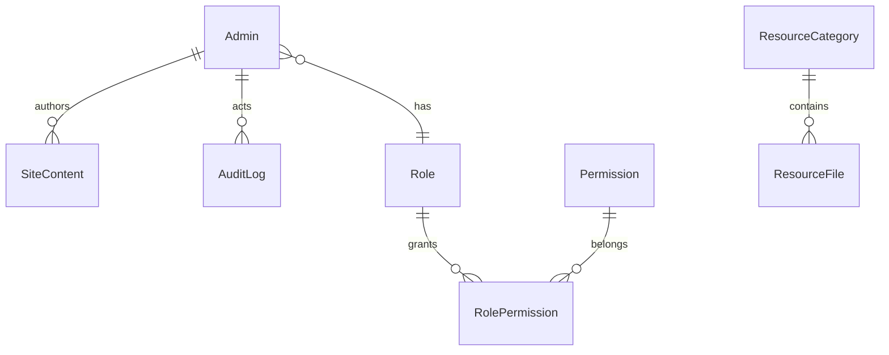

# Kiến trúc CMS tích hợp

Giữ nguyên ba workspace, Prisma/PostgreSQL và MinIO. Không tạo CMS/auth thứ hai. Public template và CSS hiện tại tiếp tục render; khi chưa có nội dung CMS, dùng dữ liệu nguồn. Nội dung đã xuất bản được đọc runtime, không cần rebuild vì đổi chữ/ảnh.

SiteContent là thực thể có sẵn, value dùng Prisma Json trên PostgreSQL. Các bản nháp/public, chương trình và phiên bản là các section/key khác nhau của cùng thực thể; không tạo bảng Pages/Blocks trùng lặp khi chưa cần.

## Quy ước dữ liệu

- cms.draft.<locale>.<id>: patch nháp theo trường và $list/$layout/$banner.
- cms.published.<locale>.<id>: patch public tách riêng.
- cms.programme.<slug>: định nghĩa ngành dùng template chung; state active/hidden/archived lưu riêng.
- cms-version: snapshot xuất bản immutable qua API CMS; published=false để public API không trả lịch sử/nháp.
- Snapshot mới có schemaVersion=1; không diễn giải snapshot phiên bản không hỗ trợ. Khôi phục tạo **bản nháp**, không tự ghi đè website; cần preview/publish riêng.
- Block đã đăng ký: text, text-image, cards, faq; composition whitelist section IDs. Thứ tự, ẩn/hiện và custom content dùng $layout; schema hiện chưa hỗ trợ mọi block trong yêu cầu (gallery/statistics/video độc lập...).
- Rich overview dùng vocabulary HTML giới hạn dựng thành React nodes; không chèn script/CSS tùy ý. Ảnh/file lưu URL MinIO, không nhúng binary vào JSON.

Snapshot lưu patch CMS, không đóng băng source code hay binary media. Khi nâng cấp code làm thay đổi schema, restore phải qua validation hiện hành và có thể bị từ chối. Audit sử dụng enum ACCOUNT_UPDATED có sẵn, targetType=website, metadata.operation phân biệt CMS_PUBLISH/CMS_RESTORE_DRAFT; chưa thêm enum/migration mới. Lịch sử vòng này áp dụng cho publish thân trang; SEO và tài nguyên có workflow riêng, chưa version hóa bởi module này.

## Phân loại module

Bắt buộc: auth/RBAC, content editor, draft/preview/publish, media upload, SEO, đồng bộ public. Hoàn thiện: history/restore, audit CMS, quản lý menu/theme có schema, asset references. Nâng cao: arbitrary page types, gallery/statistics, kéo thả đầy đủ, workflow duyệt nhiều cấp. Triển khai theo checklist, không coi module nâng cao là đã có.
